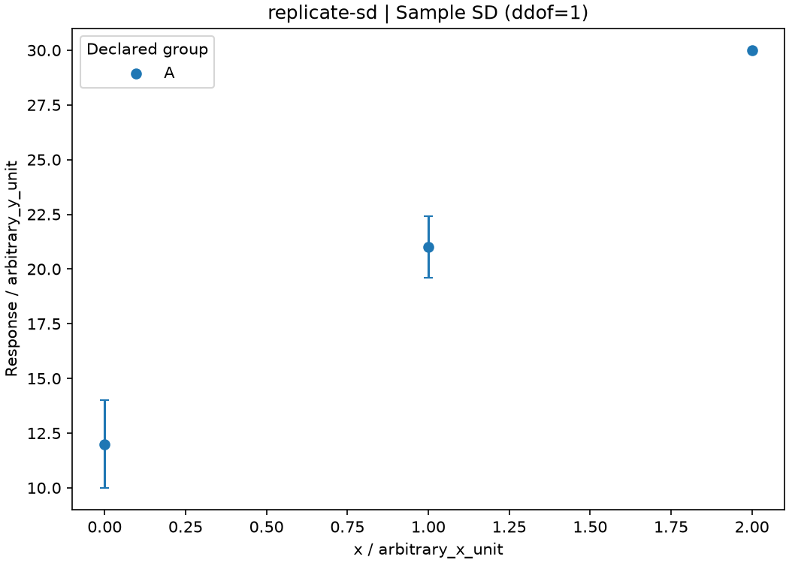

# 科研图表：实验数据与误差表达

将CSV中的实际观测画成散点图、已声明的对称误差线，或重复观测的均值与样本SD。保留原始记录和实际绘图值；图本身不证明反应机理、显著差异或测量准确度。

| 文件 | 职责 |
| --- | --- |
| 本README | 必要知识、三个案例、输入输出及操作说明 |
| [完整SKILL.md源码](SKILL.md?plain=1) | 处理指令、图形和统计边界，可下载用于自己的代理 |
| [runtime/plot_experiment.py](runtime/plot_experiment.py) | 读取Skill→验证CSV与误差定义→绘图/汇总→保存原始值和实际结果 |

程序、依赖和案例在runtime。下载[完整Python代码包](downloads/chemical-experimental-plotting-python.zip)或[Skill单文件ZIP](downloads/SKILL-md.zip)。公开GitHub文件页使用“Download raw file”保存，不把网页另存为.py。

## 误差线先说明含义

SD描述观测散布；SEM和置信区间描述的对象及所需假设不同，不能互换。本程序不从误差线自动推断其含义：用户提供yerr时，必须声明SD、SEM或CI_HALF_WIDTH；后者只照原样绘制半宽，置信水平及计算未由本程序认证。

重复观测汇总使用样本SD、ddof=1。n=1时SD未定义，留空并只画点；不会把缺失误差写0。技术重复和独立实验重复的含义由研究设计决定，不因CSV有多行就成为独立样本。本版不拟合、不平滑、不插值、不添加显著性标记，也不把示例称为真实实验。

方法约定见[Matplotlib errorbar](https://matplotlib.org/stable/api/_as_gen/matplotlib.axes.Axes.errorbar.html)和[NumPy std](https://numpy.org/doc/stable/reference/generated/numpy.std.html)。软件文档描述接口和算法，不认证实验来源或统计假设。

## 知识要点与经典依据

对同组同x的n次观测，本程序画均值及`s=sqrt(Σ(y−mean)²/(n−1))`。SD描述观测散布；在独立同分布且方差适用的观测模型下，均值标准误估计才可写成`s/sqrt(n)`。置信区间还需置信水平、分布/抽样模型等条件，不能看到误差线就认定95%CI。

反例：10、12、14的均值12、SD2，而SEM为2/√3，三者表达对象不同；单个30的SD未定义，不是0。技术重复的多个点不能自动提供独立实验的n。两个组的SD条是否重叠也不能代替对指定比较问题的统计检验。本模块不计算SEM/CI，只绘制用户声明的对称半宽，或按记录计算描述性样本SD。

[Harvey《Analytical Chemistry2.1》§4.1](https://chem.libretexts.org/Bookshelves/Analytical_Chemistry/Analytical_Chemistry_2.1_by_David_Harvey/Analytical_Chemistry_2.1_(Harvey)/04:_Evaluating_Analytical_Data/4.01:_Characterizing_Measurements_and_Results)给出Mean/Standard Deviation定义，[§4.4](https://chem.libretexts.org/Bookshelves/Analytical_Chemistry/Analytical_Chemistry_2.1_by_David_Harvey/Analytical_Chemistry_2.1_(Harvey)/04:_Evaluating_Analytical_Data/4.04:_The_Distribution_of_Measurements_and_Results)区分样本、总体与均值置信区间；开放正文已核验。Matplotlib errorbar说明画法和非负数组，不能代替教材中估计对象/前提的解释。来源与本模块未实现的推断范围见[runtime/sources.json](runtime/sources.json)。

## 安装、运行与保存

Windows解压到有写入权限的短目录，例如`D:\Chem\plot`，进入README和runtime所在目录，使用Python 3.12独立环境：

```powershell
py -3.12 -m venv .venv
.\.venv\Scripts\python.exe -m pip install -r runtime\requirements.txt
.\.venv\Scripts\python.exe runtime\plot_experiment.py --x-unit arbitrary_x_unit --y-unit arbitrary_y_unit --output ..\plot-default
```

结果必须是Skill外**全新目录**，例如第二次改为`..\plot-default-2`。目录内有原始CSV、Skill快照、参数、run-receipt.json、plotted-values.csv、observations.png、observations.svg、SHA256SUMS.txt和results.zip。复制整个目录或results.zip即可保存。失败保留已取得输入、设置和failure.json，并以非零退出；不会覆盖旧结果。

## 三个对应案例

案例均为项目编写的合成软件教学数据，单位明确标为arbitrary unit；不是化学实验数据。

| 案例 | Python调用 | 实际对应结果 |
| --- | --- | --- |
| ①原始散点 | `python runtime/examples/01_scatter.py --output ../plot-scatter` | 5条输入全部绘制为5个点，按声明A/B分组，不画连接线或未知误差 |
| ②用户提供SD | `python runtime/examples/02_supplied.py --output ../plot-supplied` | 3个点；yerr分别1、2、1.5，以SD标记，数值照原样保存，不换成SEM |
| ③重复观测与SD | `python runtime/examples/03_replicates.py --output ../plot-replicates` | x=0的10、12、14→均值12、SD2；x=1的20、22→均值21、SD√2；x=2的30只有1条，SD留空、只画点 |

Windows将python替换为`.\.venv\Scripts\python.exe`。完整案例源码：[①](runtime/examples/01_scatter.py)、[②](runtime/examples/02_supplied.py)、[③](runtime/examples/03_replicates.py)。



图中没有连线或拟合。单独的x=2点没有可定义的样本SD，并不表示其真实不确定度为0。

## 用户CSV与参数修改

UTF-8 CSV，≤128000字节，1–1000条；id唯一且非空，group由用户提供，x/y全部有限。重复观测使用不同id：

```csv
id,x,y,group,yerr
001,0,10,A,1
002,1,20,A,2
003,2,15,A,1.5
```

保存为Skill外的`..\my-plot.csv`，提供你实际采用的单位和误差定义：

```powershell
.\.venv\Scripts\python.exe runtime\plot_experiment.py --input ..\my-plot.csv --mode supplied-error --error-type SD --x-unit min --y-unit area_au --output ..\my-plot-results
```

改为`--error-type SEM`只改变所声明的误差含义，不转换数值，必须确保输入本来就是SEM。按原始重复观测汇总时使用`--mode replicate-sd`并去掉error-type；只画原点使用`--mode scatter`。单位只作标签、不换算，不能混合不同单位的数据。本版不支持非对称误差或对数轴；不把它们静默改成支持的形式。

## 完整Skill调用模板

[call_skill_template.py](runtime/examples/call_skill_template.py)为完整可运行模板；核心流程为：

```python
from plot_experiment import run_skill

receipt = run_skill(
    input_csv="../my-plot.csv", output_dir="../my-plot-results-2",
    x_unit="min", y_unit="area_au",
    mode="supplied-error", error_type="SD",
)
print(receipt)
```

调用时runtime须在Python模块路径中，完整模板已处理路径。run_skill实际读取顶层完整SKILL.md并保存哈希，运行固定绘图工具；不联网、不调用模型，也不宣称语言模型理解了Skill。

代码包完整性见[SHA-256](downloads/SHA256SUMS.txt)；内部验收材料不进入用户包。
