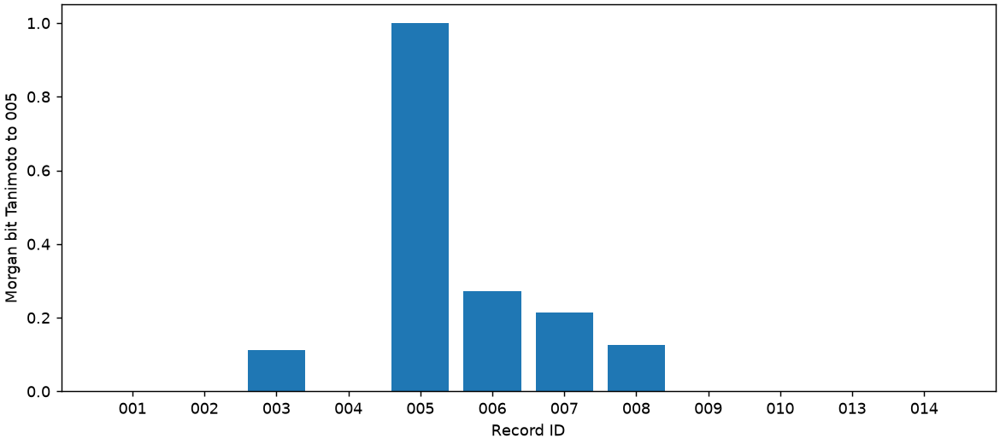

# SMILES与RDKit：运行与下载

[教学介绍与来源](README.md) · [阅读及下载Notebook](organic-smiles-rdkit.ipynb) · [配置说明](CONFIGURATION_zh-CN.md) · [开始使用](../../START_HERE_zh-CN.md)

## 下载材料

| 文件 | 用途 |
| --- | --- |
| [运行Notebook](organic-smiles-rdkit.ipynb) | 包含教学文字、默认折叠的准备单元、参数表单、真实调用与结果下载程序；保存图表供阅读 |
| [材料ZIP](organic-smiles-rdkit-materials.zip) | 同一已验Notebook、Skill、源码、模板、样本与来源 |
| [参数](parameters.json) · [调用模板](task-template.txt) | 默认radius=2，修改为3比较指纹 |
| [数据CSV](molecules.csv) · [数据来源](data-provenance.json) · [知识来源](sources.json) | 14条教学记录及错误输入身份 |
| [示例结果ZIP](example-results.zip) | 已验两轮的CSV、数值、PNG、参数和清单；经过精选，不含模型轨迹和私人标识 |
| [结构图](example-molecules.png) · [相似度图](example-similarity.png) | 来源Notebook保存的真实程序输出 |

全仓文件SHA见[SHA256SUMS](../../SHA256SUMS.txt)；示例结果ZIP自带逐文件清单。源资源的原SHA清单保留供身份核对，不代替全仓清单。

## 到Colab运行

1. 使用已授权GitHub账号打开Notebook文件页，点击Download raw file保存.ipynb。
2. 打开[Google Colab](https://colab.research.google.com/)，选择“文件→上传笔记本”，上传并在自己的账号保存副本。私有仓库不使用匿名直读链接，不向代码填写GitHub令牌。
3. 按配置说明在自己的Colab Secret中授权DEEPSEEK_API_KEY；本地使用自己选择的.env。不要在代码中填写密钥值或上传整个.env。
4. 从头运行；默认radius=2，再修改为3重跑参数、凭据、调用和显示单元。每轮使用新输出目录。已保存示例不等于你刚执行了新调用。
5. “文件→下载→下载.ipynb”保存执行Notebook。结果ZIP可在课末下载；若Chrome富输出加载异常，从左侧“文件”面板找到本次organic-rdkit工作目录和run目录，对organic-smiles-rdkit-results.zip选择下载；全部运行合并ZIP位于工作目录。

新运行需要自己的Google账号、DeepSeek凭据、网络和额度。依赖安装和数值计算在会话独立环境进行，CPU即可。Notebook运行代码与已验两轮样板保持原字节；本次发布没有再次调用付费模型。

