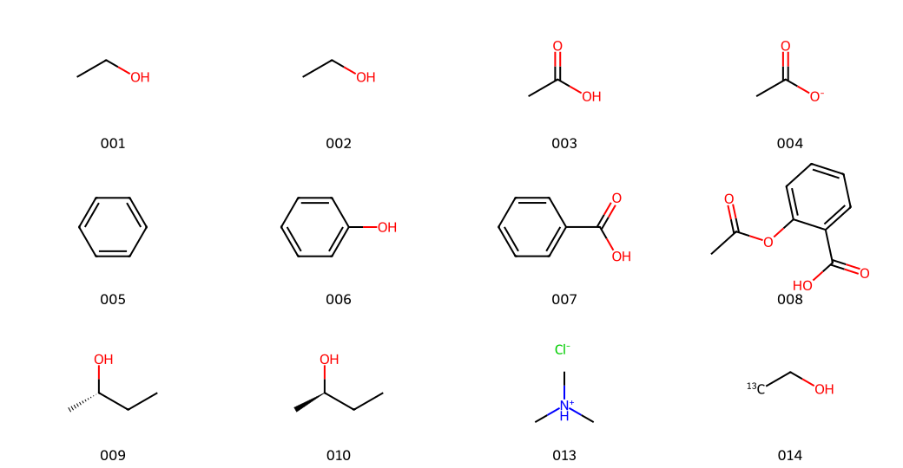
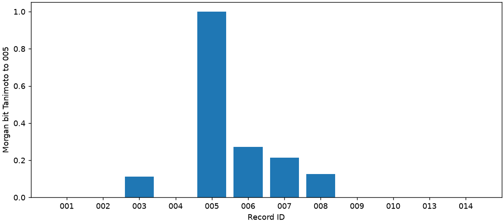

# SMILES 与 RDKit

分类：**有机分子结构与身份识别** · Skill：`organic-smiles-rdkit`

学习将分子结构写成SMILES，调用SKILL.md完成结构解析、描述符、SMARTS匹配与Morgan指纹比较。先阅读知识与数据说明，再看对应的调用和结果；运行Notebook入口在本页下部。

## 知识与数据来源

### 学习目标

需要基本的有机结构、官能团、电荷与立体化学知识。通过本例，辨别“同一结构的不同写法”与“不同化学身份”，读懂输入、参数和输出文件之间的关系。

### 本页学什么

SMILES描述结构，SMARTS描述查询模式；规范SMILES用于同版本下比较表示；描述符给出算法计算值，Morgan指纹与Tanimoto衡量所选表示的相似度。本例保留盐、电荷、立体与同位素信息，不做结构标准化或活性/机理推断。

### 必要知识与参考资料

**以下主体是语言规范说明和软件官方文档，并非“经典有机化学教材”。** 它们分别回答“符号怎样解释”和“程序怎样计算”。方法论文另列为延伸阅读；不把未核对的教材章节或未读全文列为已核验依据。

| 知识点 | 本例中的含义 | 资料类型与具体章节 |
| --- | --- | --- |
| SMILES的连接、芳香性、电荷、组分 | 保留苯环、离子、盐的结构身份 | 语言规范说明：[Daylight §3.2.1–3.2.5](https://www.daylight.com/dayhtml/doc/theory/theory.smiles.html) |
| 同位素与局部手性 | 不凭@/@@直接命名R/S，不补写未指定构型 | 语言规范说明：[Daylight §3.3.1、§3.3.3](https://www.daylight.com/dayhtml/doc/theory/theory.smiles.html) |
| 规范表示与结构解析 | CCO/OCC都表示乙醇；按本例RDKit版本核对 | 官方教程：[Reading single molecules、Writing molecules](https://www.rdkit.org/docs/GettingStartedInPython.html)；Daylight §3.1 |
| SMARTS子结构查询 | `[CX3](=O)[OX2H1]`查含OH的羧酸片段 | 语言规范说明：[Daylight §4.1原子、§4.2键、§4.3逻辑](https://www.daylight.com/dayhtml/doc/theory/theory.smarts.html) |
| 平均分子量、MolLogP、TPSA | g/mol、模型估计值、Ų；不当作实验测量 | 官方API：[MolWt](https://www.rdkit.org/docs/source/rdkit.Chem.Descriptors.html)、[Crippen MolLogP](https://www.rdkit.org/docs/source/rdkit.Chem.Crippen.html)、[CalcTPSA](https://www.rdkit.org/docs/source/rdkit.Chem.rdMolDescriptors.html#rdkit.Chem.rdMolDescriptors.CalcTPSA) |
| Morgan指纹与Tanimoto | 半径、位数及手性设置影响比较结果 | 官方API：[GetMorganGenerator](https://www.rdkit.org/docs/source/rdkit.Chem.rdFingerprintGenerator.html)；[Fingerprints and Molecular Similarity](https://www.rdkit.org/docs/GettingStartedInPython.html#fingerprints-and-molecular-similarity) |
| Murcko骨架 | 提取环系及连接部分，无环分子另标为空骨架 | 官方教程：[Murcko Decomposition](https://www.rdkit.org/docs/GettingStartedInPython.html#murcko-decomposition) |

对本例位集合，$T(A,B)=|A\cap B|/|A\cup B|$，空并集约定1；程序用位集合独立复算。相似度1不能证明化学身份或生物活性相同。

延伸阅读：Weininger（1988）的[SMILES方法论文](https://doi.org/10.1021/ci00057a005)，28(1):31–36；Rogers与Hahn（2010）的[圆形指纹方法论文书目与摘要](https://pubmed.ncbi.nlm.nih.gov/20426451/)，50(5):742–754，DOI:10.1021/ci100050t。前者核对出版社书目，后者核对书目与索引摘要；不声称本次取得并核对两篇全文。

### 数据从哪里来

`molecules.csv`是本项目组织和核对的14条通用结构教学输入，包含重复写法、酸/酸根、芳香结构、手性、盐、同位素及两条故意无效记录；不是实验数据或外部课程数据文件。`source_id=project`是本例输入构造/核对标签，不是数据库下载标识。逐记录说明和文件哈希在`data-provenance.json`，方法依据在`sources.json`。

AI4Chem只作为Skill选题与页面组织的参考，不列为本Skill知识或数据取材来源。本版不收录该课程的正文、图片、代码或Notebook，不主张获得其再分发授权。

### CSV和JSON分别怎样用

| 单文件（查看/另存为） | 用途 | 用户操作 |
| --- | --- | --- |
| [molecules.csv](https://github.com/CCcolab/AI4OrgChem-data-processing/raw/5d14cc3affe25d257eba042264617427bdcb83fb/skills/organic-smiles-rdkit/runtime/molecules.csv) | 输入；列为id、label、smiles、source_id、role | Excel可选UTF-8并把id列设为文本保留001；也可用下面代码读入。保留011/012反例 |
| [parameters.json](https://github.com/CCcolab/AI4OrgChem-data-processing/raw/5d14cc3affe25d257eba042264617427bdcb83fb/skills/organic-smiles-rdkit/runtime/parameters.json) | 五个参数的默认模板 | 对照参数表；Notebook实际采用②表单/代码中的字典，下载后修改本地文件不会自动改动云端运行 |
| [data-provenance.json](https://github.com/CCcolab/AI4OrgChem-data-processing/raw/5d14cc3affe25d257eba042264617427bdcb83fb/skills/organic-smiles-rdkit/runtime/data-provenance.json) | 输入构造、逐记录说明及molecules.csv哈希 | 用文本编辑器阅读；用于核对输入身份，不是待拟合的数据，不是密钥配置 |
| [sources.json](https://github.com/CCcolab/AI4OrgChem-data-processing/raw/5d14cc3affe25d257eba042264617427bdcb83fb/skills/organic-smiles-rdkit/runtime/sources.json) | 知识点、章节、URL、资料类型和核对范围 | 阅读及查证；不作为模型参数或CSV上传 |

单文件链接可能先显示文本；如需保存，按Ctrl+S并保留表中原文件名。也可[打开输入与配套模块ZIP文件页](https://github.com/CCcolab/AI4OrgChem-data-processing/blob/5d14cc3affe25d257eba042264617427bdcb83fb/skills/organic-smiles-rdkit/runtime/rdkit-runtime.zip)，在文件页点击右上角`Download raw file`（下载原始文件），解压后四份文件都在根目录。

本例Notebook已携带这四份文件，①准备环境会写入运行目录，无需先手动上传。点击上述下载链接需已登录且有本私有仓库权限。运行后结果包也保留这些说明文件。

```python
# 在Notebook①准备环境之后，可选：查看实际读入的输入和说明
import csv, json
with (lab.workspace / "molecules.csv").open(encoding="utf-8", newline="") as f:
    inputs = list(csv.DictReader(f))
provenance = json.loads((lab.workspace / "data-provenance.json").read_text("utf-8"))
references = json.loads((lab.workspace / "sources.json").read_text("utf-8"))
print(len(inputs), provenance["dataset_id"])  # 14 organic-smiles-teaching-structures-v2
```

## 调用与输出

### 调用模板与参数含义

先运行Notebook①，得到`lab`；再按下列模板设置**本次实际传入**的参数。`SKILL.md`原文由程序读取并传给Agent，不把文件名当作已调用。

```python
parameters = {
    "radius": 2,
    "fp_size": 2048,
    "include_chirality": True,
    "query_smarts": "[CX3](=O)[OX2H1]",
    "reference_id": "005",
}
skill_file = lab.workspace / "SKILL.md"
skill_text = skill_file.read_text(encoding="utf-8")
run_output = lab.call_skill(skill_text=skill_text, parameters=parameters)
lab.show_results(run_output)
lab.show_downloads(run_output)
```

| 模板字段 | 本例值/范围 | 对应输出与应观察的变化 |
| --- | --- | --- |
| radius | 2；1–4整数 | 改为radius=3后，比较similarity.csv的tanimoto及analysis.csv的fingerprint_on_bits；分子式/描述符不应因此改变 |
| fp_size | 2048；1024/2048/4096 | Morgan位向量长度；改变会影响指纹碰撞和相似度 |
| include_chirality | True；布尔值 | 指纹及查询是否使用手性；不能据此删除原始SMILES中的立体信息 |
| query_smarts | `[CX3](=O)[OX2H1]` | analysis.csv的query_match_count；003、007、008各1，004乙酸根为0 |
| reference_id | "005"；有效输入ID | similarity.csv的reference_id均为005；苯与自身相似度为1 |

### 本页工具的输入与执行边界

本轮边界约定为`rdkit-bounded-teaching-v2`；五个分析参数及内置14条结构保持一致。

Notebook使用内置的14条教学输入，不提供任意CSV上传入口。配套工具用于本地开发复核时要求：UTF-8、五列完整、ID唯一且为1–64位字母/数字/点/下划线/连字符（字母或数字开头）；1–50行，CSV不超过128000字节，SMILES不超过512字符、每个分子不超过128个原子。字段不接受控制字符或电子表格公式前缀。名称请放label列；结构列只接收SMILES，不接受名称后缀、CXSMILES或虚拟原子。无效结构按行保留，参照ID必须有效。

SMARTS不超过120字符、32个查询原子；匹配超过1000项时明确拒绝统计，防止将截断数当成完整结果。解析后原子索引从0开始，指向本轮RDKit分子，不是原始字符串的字符位置。接口依据：[RDKit名称与CXSMILES解析说明](https://www.rdkit.org/docs/RDKit_Book.html#reading-molecule-names)、[GetSubstructMatches与maxMatches](https://www.rdkit.org/docs/source/rdkit.Chem.rdchem.html#rdkit.Chem.rdchem.Mol.GetSubstructMatches)；本页固定版本另以实际接口和反例复核。

调用前复核全部运行资源，并在发送模型请求前检查输入格式和参照结构；模型只能使用一次限定工具，最多3轮请求、每轮60秒，不自动重试，不跟随API重定向。模型响应上限1MB；分析子进程230秒，超时后终止，清理最多15秒。失败不生成成功验收回执。合并下载最多20轮、20MB清单数据，超限时仍提供本轮下载，不收录清单以外的临时文件。以上是单用户教学任务边界，不是多用户服务的负载能力保证。

### 实际参数调用案例与输出结果

下面是**同一输入、同一固定程序**在本地重算的两组保存结果，不是模型编写的数值。默认组严格采用上面的全部参数；对照组只把`radius`从2改为3，其余四项不变。两组均14条记录、12有效、2拒绝，16项程序检查通过。001/002规范表示相同但两行都保留；011/012进入errors.csv。

| ID | 分子式 | MolWt (g/mol) | 羧酸查询匹配数 | Tanimoto：radius=2 | Tanimoto：radius=3 |
| --- | --- | --- | --- | --- | --- |
| 001 | C2H6O | 46.069 | 0 | 0.000000 | 0.000000 |
| 002 | C2H6O | 46.069 | 0 | 0.000000 | 0.000000 |
| 003 | C2H4O2 | 60.052 | 1 | 0.111111 | 0.100000 |
| 004 | C2H3O2- | 59.044 | 0 | 0.000000 | 0.000000 |
| 005 | C6H6 | 78.114 | 0 | 1.000000 | 1.000000 |
| 006 | C6H6O | 94.113 | 0 | 0.272727 | 0.214286 |
| 007 | C7H6O2 | 122.123 | 1 | 0.214286 | 0.166667 |
| 008 | C9H8O4 | 180.159 | 1 | 0.125000 | 0.093750 |
| 009 | C4H10O | 74.123 | 0 | 0.000000 | 0.000000 |
| 010 | C4H10O | 74.123 | 0 | 0.000000 | 0.000000 |
| 011 | — | — | — | 拒绝 | 拒绝 |
| 012 | — | — | — | 拒绝 | 拒绝 |
| 013 | C3H10ClN | 95.573 | 0 | 0.000000 | 0.000000 |
| 014 | C2H6O | 47.061 | 0 | 0.000000 | 0.000000 |

数值在表中按显示精度舍入，CSV保留程序精度；“—/拒绝”不是0或缺失值填零。完整[两组样例输出ZIP（文件页）](https://github.com/CCcolab/AI4OrgChem-data-processing/blob/5d14cc3affe25d257eba042264617427bdcb83fb/skills/organic-smiles-rdkit/assets/example-results.zip)包含输入、参数、CSV、图表、数值检查及样例清单；在文件页点击`Download raw file`保存。程序生成的图对应**默认组radius=2**：




| 输出文件 | 与本次调用的对应关系 | 阅读方法 |
| --- | --- | --- |
| parameters.json | 保存实际使用的五个参数 | 先核对与本次字典/表单完全一致 |
| analysis.csv | 14条输入的逐行结果，含解析状态、原结构、分子式、描述符及匹配数 | 按id对齐；拒绝行不当作零结果 |
| errors.csv / duplicates.csv | 分别保留011/012及002→001映射 | 错误/重复只报告，不静默删除 |
| similarity.csv | 有效记录与reference_id的指纹相似度，含独立位集合核算 | 比较同一id在两组参数下的值 |
| numerical-result.json | 记录数量、参数、方法环境和16项检查 | 确认参数与checks；不把模型文字替代它 |
| molecules.png / similarity.png | 本次结构图和相似度图 | 用ID与输入及CSV对应 |

真实Agent运行后，还会得到`run-receipt.json`、`agent-trace.json`和`agent-explanation.md`；上面的**本地数值样例没有伪造模型调用回执或解释**。实际执行和文件下载状态以本轮程序回执及实际下载文件为准。

## 运行与下载

**[打开运行Notebook](organic-smiles-rdkit.ipynb)**

Notebook内提供“在Colab运行”按钮、首次账号授权、保存副本、Secret配置与①至⑤步骤。Colab读取同名`DEEPSEEK_API_KEY` Secret；不要把值写进代码或上传.env。Notebook①使用Colab接口；本地Python应使用配套模块，而非直接执行该Colab准备单元。

本地使用配套模块时，在已安装requirements-colab.txt依赖的Python 3.12/3.13环境运行；将模块ZIP解压到同一目录，再使用：

```python
from pathlib import Path
import json
from colab_workflow import Lab

ENV_FILE = Path.home() / ".env"  # 改为自己已有的配置文件，不填写密钥值
lab = Lab.prepare(Path("rdkit-runtime.zip"))
parameters = json.loads((lab.workspace / "parameters.json").read_text("utf-8"))
skill_text = (lab.workspace / "SKILL.md").read_text("utf-8")
run_output = lab.call_skill(skill_text=skill_text, parameters=parameters, env_file=ENV_FILE)
print(run_output)  # 在此目录查看程序回执与结果ZIP
```

**[查看SKILL.md源码（Code）](https://github.com/CCcolab/AI4OrgChem-data-processing/blob/main/skills/organic-smiles-rdkit/SKILL.md?plain=1)**

### 分别下载Notebook和SKILL.md

- [下载Notebook](https://github.com/CCcolab/AI4OrgChem-data-processing/raw/5d14cc3affe25d257eba042264617427bdcb83fb/skills/organic-smiles-rdkit/organic-smiles-rdkit.ipynb)
- [下载SKILL.md](https://github.com/CCcolab/AI4OrgChem-data-processing/raw/5d14cc3affe25d257eba042264617427bdcb83fb/skills/organic-smiles-rdkit/SKILL.md)
- [完整配套模块ZIP](https://github.com/CCcolab/AI4OrgChem-data-processing/blob/5d14cc3affe25d257eba042264617427bdcb83fb/skills/organic-smiles-rdkit/runtime/rdkit-runtime.zip)

样例CSV/JSON的独立下载及用法见上面的文件表。真正运行后在Notebook⑤下载本轮结果；含输出的执行版用“文件→保存”，再选“文件→下载→下载.ipynb”。

开发者复核：在仓库根目录、已安装配套依赖的Python环境运行`python -B -m unittest discover -s tests/rdkit -p "test_*.py" -v`。测试覆盖输入边界、参数组合、化学身份、资源篡改、超时和下载；模型响应使用离线模拟，不消耗API额度，也不代替Colab真实验收。
