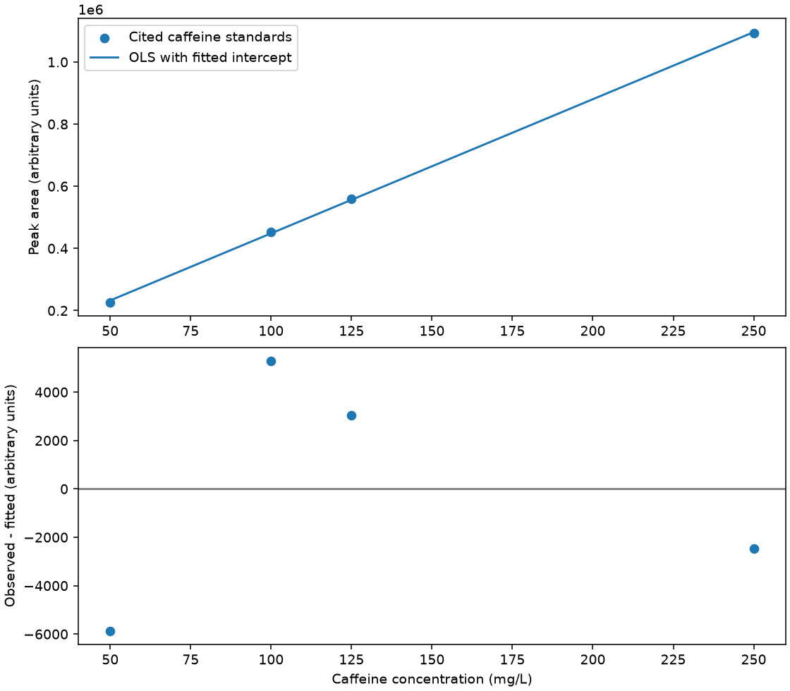

# 表格拟合与残差分析

分类：**有机分析与实验数据处理** · Skill：`table-fitting-residuals`

通过Python程序复核有明确来源的咖啡因HPLC校准表。

## 学习目标

| 层次 | 本页练习 |
| --- | --- |
| 跟随操作 | 用标准液浓度与峰面积拟合直线，绘图，反算待测浓度，改变标准点范围后比较结果 |
| 独立解释 | 解释斜率、截距、残差、RSS与R²的意义，区分数值拟合、仪器误差原因和实验测量 |

需要读表、单位、简单代数与基本分析化学知识。

## 这项Skill能帮你做什么

它指导Agent检查表格、单位和拟合目的，选择明确模型，调用数值工具，解释残差和局限。原文允许多种分析任务；**本页实现仅限未加权、带截距线性OLS校准**，不声称覆盖加权、非线性、因果分析或完整Skill测试。

示例问题：已知咖啡因标准液浓度及HPLC峰面积，怎样得到校准关系？峰面积424195对应多少mg/L？拟合残差告诉我们什么？只用前三个标准时结论如何变化？

## 知识与数据有何来源

数据逐项转录自 David Harvey《Analytical Chemistry 2.1》12.5节 **Exercise 12.5.2**，不是模型生成数据，也不是本项目实测。该题列出咖啡因反相HPLC标准液表和待测峰面积，给出的浓度答案约94.4 mg/L。[教材原页](https://chem.libretexts.org/Bookshelves/Analytical_Chemistry/Analytical_Chemistry_2.1_by_David_Harvey/Analytical_Chemistry_2.1_(Harvey)/12:_Chromatographic_and_Electrophoretic_Methods/12.05:_High-Performance_Liquid_Chromatography)

| 咖啡因浓度 mg/L | 峰面积，任意单位 |
| --- | --- |
| 50.0 | 226724 |
| 100.0 | 453762 |
| 125.0 | 559443 |
| 250.0 | 1093637 |

数据语境为同一题设条件下10 µL进样。这里使用已提供的数据，不操作仪器、不产生新的实验记录。教材追溯引用Kusch与Knupp，*Chem. Educator*，2003，8，201–205；本轮核对的是教材转录页，没有声称直接复核原论文原始实验数据。

教材页面标注作者David Harvey、CC BY-NC-SA 4.0。数据表和这一教材语境说明注明该来源及其许可，不为项目既有代码新增许可证，不复制原教材图。本站校准和残差图由本例数据重新计算生成。

最小二乘方法依据 [NIST统计手册：Least Squares](https://www.itl.nist.gov/div898/handbook/pmd/section4/pmd431.htm)。本例设浓度为x、峰面积为y，拟合：

$$\hat y=a+bx,\qquad RSS=\sum_i(y_i-\hat y_i)^2.$$

残差约定为观测减预测，反求浓度使用同一个校准模型：

$$e_i=y_i-\hat y_i,\qquad x_{sample}=(y_{sample}-a)/b.$$

残差检查与“高R²不充分”的说明依据 [NIST：How can I tell if a model fits my data?](https://www.itl.nist.gov/div898/handbook/pmd/section4/pmd44.htm)。本题只有4点且无重复；残差图是诊断起点，不能据此证明模型充分或方差恒定。本页不提供未经验证的置信区间、检出限或反应机理结论。


[逐项知识来源与章节](runtime/sources.json) · [数据转录与许可说明](runtime/data-provenance.json) · [原始浓度/峰面积CSV](runtime/caffeine-calibration.csv)

## 保存的示例图表

以下是来源样板真实四点运行的保存输出，供在线阅读；不代表刚打开网页就已完成新的模型调用。



反算浓度94.37792857876974 mg/L。正的拟合截距本身不能确立基线或系统误差的物理成因。示例参数见[结果JSON](assets/example-result.json)，当前数值以本地运行输出为准。


## 怎样解释结果

默认使用4个标准点，样品峰面积为424195，反算浓度接近教材答案94.4 mg/L；具体数值以实际运行输出为准。斜率单位为峰面积单位/(mg/L)，截距单位为峰面积单位，残差采用观测减预测。

改用前三个点是样本范围敏感性练习，不能据此断定最高标准点错误。4个点且没有重复测量，不能单凭高R²认定方差恒定或给出机理结论；模型解释与数值检查分别阅读。

## 自测

1. 为什么本例保留拟合截距？正截距能否单独证明基线偏差？
2. 去掉最高标准点后，应该比较哪些结果？能否据此直接删去该点？
3. 题设没有给出额外稀释倍数时，能否自行添加？

## 调用、参数与对应输出

默认：`python table-fitting-residuals.py --output ../results-four-standards`。参数模板见[runtime/parameters.json](runtime/parameters.json)。

| 参数 | 含义 | 对应输出 |
| --- | --- | --- |
| include_highest_standard=true | 4个标准；改为false明确选择前三点 | numerical-result.json中的n与used_ids、拟合系数与反算浓度、残差图 |
| unknown_peak_area=424195.0 | 峰面积，任意单位；有限非负数 | sample_concentration_mg_L；默认约94.37793 mg/L |
| fit_intercept=true | 拟合截距，不支持强制过原点 | intercept、slope、RSS、R²与残差 |

这是未加权、带截距的限定线性OLS样板，不扩展声称加权/非线性、自动删点或实验不确定度验证。原始表格见[runtime/caffeine-calibration.csv](runtime/caffeine-calibration.csv)，数据出处及许可见[数据来源](runtime/data-provenance.json)，方法和章节见[知识来源](runtime/sources.json)。

结果中的`fitted-and-residuals.csv`逐行对应标准ID；`numerical-result.json`包含45位Decimal独立公式复核；`calibration-and-residuals.png`显示校准与观测减预测残差。选择前三点是范围敏感性分析，不是认定最高点错误。数值模式不会生成模型解释或真实Agent调用回执。

## 运行与下载

推荐下载[完整Python代码包](downloads/table-fitting-residuals-python.zip)，解压并进入该Skill目录。程序入口为[table-fitting-residuals.py](table-fitting-residuals.py)，同级保留`runtime`目录。单独下载入口文件不能代替完整代码包。

Windows PowerShell示例；先安装Python 3.12或3.13：

```powershell
python -m venv .venv
.\.venv\Scripts\python.exe -m pip install -r requirements.txt
.\.venv\Scripts\python.exe table-fitting-residuals.py --output ..\results-default
```

macOS/Linux使用`.venv/bin/python`执行同样的安装和运行命令。默认模式只做本地数值计算，无需模型账号、API密钥或联网请求；依赖首次安装需要获取对应软件包。

完成后双击结果目录的`report.html`查看回执、参数和图表；保留`results.zip`及`results.zip.sha256`。报告为自包含HTML，没有外部脚本、输出框架或本地Web服务。代码输出`PASS_LOCAL_NUMERICAL`，明确表示没有调用模型。

### 修改参数再运行

复制[runtime/parameters.json](runtime/parameters.json)为自己的参数文件，按上表修改后运行到新目录：

```powershell
.\.venv\Scripts\python.exe table-fitting-residuals.py --params my-parameters.json --output ..\results-modified
.\.venv\Scripts\python.exe table-fitting-residuals.py --verify ..\results-modified
```

已有结果目录拒绝覆盖；`--verify`只核对文件和ZIP的SHA-256，不重复计算。

### 可选：让Agent读取SKILL.md并解释结果

`SKILL.md`是给AI助手的技能指令；`.py`是执行数值计算的程序。默认数值模式读取并记录Skill身份，不能把它称为真实Agent调用。确需模型解释时，再显式开启：

```powershell
.\.venv\Scripts\python.exe table-fitting-residuals.py --agent --env-file .env --output ..\results-agent
```

`.env`是自己已有的本地配置文件，程序只读其中`DEEPSEEK_API_KEY`，不把值写进代码、命令行、日志或结果包；不自动读取其它配置。该模式使用自己的DeepSeek账号和额度，不使用OpenAI服务。不配置`--agent`就不会读取密钥或调用模型。真实模式必须有实际工具调用回执，模型文字不能替代程序文件检查；本次迁移只做离线模拟验证，没有新增真实模型调用。

### 下载文件

- [完整Python代码包](downloads/table-fitting-residuals-python.zip)：入口、Skill、依赖清单及配套源码与数据。
- [查看Python入口源码](table-fitting-residuals.py) · [查看SKILL.md源码](SKILL.md?plain=1) · [依赖清单](requirements.txt)。

仓库为私有；取得完整代码包后，日常运行只需要本地Python环境。33项Skill按专业分类组织，本页仅承诺上述已实现的限定任务。
